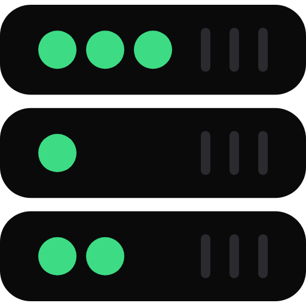

<div align="center">



# Toni Infrakit

**Ferramentas de desktop para a equipe de infraestrutura. Começa pelas impressoras: encontrar, escolher o driver,
instalar e testar, numa tela só.**

Irmão do [Toni Devkit](https://github.com/tonissx/toni-devkit): mesma base (Electron, design system, atualização
automática e release), com um foco diferente.

</div>

---

## Impressoras

1. **Procurar.** Varre a rede deste computador (ou as faixas que você informar) atrás das portas de impressão
   (9100 RAW, 631 IPP e 515 LPD) e ouve os anúncios Bonjour/mDNS. Nas impressoras que respondem, pergunta o modelo,
   o status e o nível de toner via IPP e SNMP (só leitura). Impressoras USB e WSD aparecem pelo próprio Windows,
   inclusive as que estão **sem driver**.
2. **Escolher o driver.** O app mostra os drivers compatíveis em ordem de confiança:
   - **ID de hardware igual** a um modelo de um `.inf` do repositório da equipe;
   - driver **já instalado** neste Windows para o mesmo modelo;
   - `.inf` do repositório com o **mesmo modelo** pelo nome;
   - **driver de classe IPP da Microsoft**, sem driver do fabricante, para impressoras IPP Everywhere/Mopria;
   - **driver universal** do fabricante;
   - **PCL6 genérico** da Microsoft, como último recurso.

   Sem nada compatível, ele abre a busca no Microsoft Update Catalog e no site do fabricante, no navegador.
3. **Instalar.** Uma única elevação (UAC): `pnputil` adiciona o driver, `Add-PrinterDriver` registra, e a porta
   TCP/IP e a fila são criadas. Por IPP, a fila é criada com `Add-Printer -IppURL`. Por USB, o Windows cria a fila
   ao reconhecer o aparelho. O driver é copiado do repositório para uma pasta local antes, porque o processo elevado
   não enxerga as unidades de rede mapeadas do usuário.
4. **Testar.** Envia a página de teste do Windows e acompanha o trabalho na fila até sair ou dar erro.

Tudo fica no **Histórico**, com os passos de cada instalação e um botão para copiar para o chamado.

### O repositório de drivers

O app **não baixa drivers da internet**. A equipe mantém uma pasta, local ou de rede (`\\servidor\drivers`), com os
drivers **extraídos** (com o `.inf`). Configure-a na aba **Drivers** e clique em **Reindexar**. O app lê os modelos e
os IDs de hardware de cada `.inf` x64 de impressora.

## Desenvolvimento

```bash
npm install
npm run dev      # build + Electron com DevTools
npm test         # testes (node --test)
npm run icon     # gera build/icon.png e renderer/assets/icon.png a partir de renderer/assets/symbol.svg
npm run dist     # instalador e portátil para Windows x64
```

O push em `main` gera a release no GitHub (`.github/workflows/release.yml`), e o app instalado se atualiza sozinho.

### Estrutura

| Pasta | O que tem |
| --- | --- |
| `electron/` | Processo principal: janela, IPC, atualização |
| `electron/printers/` | Serviço de impressoras, PowerShell (normal e elevado), rede (TCP, IPP, SNMP, mDNS), repositório de drivers |
| `src/printers/` | Lógica pura e testada: IPP, SNMP, mDNS, `.inf`, faixas de IP, junção das fontes, escolha de driver, scripts PowerShell |
| `src/tools/` | Telas das ferramentas (registro em `src/tools/meta.js` e `registry.js`) |
| `renderer/ds/` | Design system do Toni Devkit (o mesmo arquivo, sem alterações) |

## Requisitos

- **Windows 10 ou 11, 64 bits.** As ferramentas usam o spooler, o PowerShell 5.1 e o `pnputil` do Windows.
- Instalar e remover impressoras pede **permissão de administrador** (UAC). Procurar, testar e definir a padrão, não.

## Licença

MIT. Veja [`LICENSE`](LICENSE) e [`THIRD-PARTY-NOTICES.md`](THIRD-PARTY-NOTICES.md).
